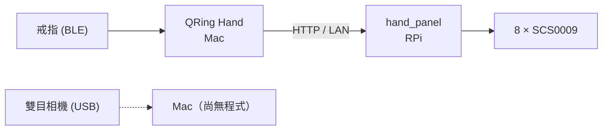
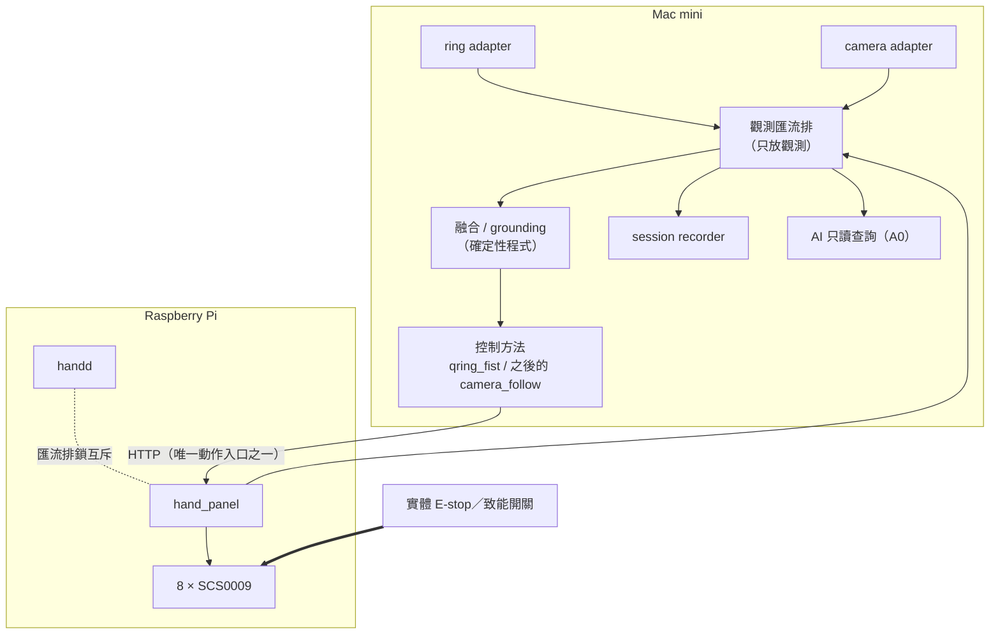

# 元件連動規劃：右手 × 雙目相機 × 戒指，以及之後的 X

- 狀態：規劃草稿（2026-10-19），不是決策。要動手的項目各自開 ADR。
- 範圍：現有三個元件怎麼搭配、之後可以加哪些元件、兩兩與三者連動能做什麼、會遇到的障礙。

## 0. 一句話

**戒指是操作者的感測器，相機是機器人的眼睛，手是機器人的致動器。**
三者接起來最有意思的，不是「多一種遙控方式」，而是用因果相關分辨「哪隻手是我的、哪隻是你的」——這正是本專案的核心命題（[00](00_PROJECT_VISION.md)、[HISTORY](HISTORY.md) 的 S1 工程定義）。

## 1. 現況（2026-10-19）

| 元件 | 接在哪 | 拿得到的資料 | 已做到 | 還沒做 |
|---|---|---|---|---|
| 右手 `hand.right` | Raspberry Pi 4（`/dev/ttyACM0`） | 8 顆伺服的位置、電壓、溫度；**沒有電流或力** | 網頁面板（ADR-0007）、戒指跟隨（ADR-0008）、`hand_api` P1／P2（模擬，ADR-0006） | 實體 E-stop、實機故障注入、real-hardware validation |
| 雙目相機 | Mac mini USB | 2560×720 MJPG 併排（FPS 未量） | Photo Booth 目視：彩色、併排 | ADR-0005 驗證 1–10 全部、擷取程式、校正、fake adapter |
| 戒指 QRing R08 | Mac 藍牙 | 三軸加速度（含重力，約 10–15 Hz）、觸控事件（單擊／上滑／下滑／長按）、電量；戒指 repo 另有按需心率／血氧 | 握拳跟隨 0.1.1（實機 bring-up 觀察，沒有 experiment ID） | 端到端延遲、Linux／BlueZ、多數中止路徑的實機紀錄 |

目前的連動只有一條：

## 2. 先分清楚三種角色

| 元件 | 對機器人而言 | manifest `ownership` | 可以讓手動嗎 |
|---|---|---|---|
| 右手 | 自己的致動器 | `intrinsic` | 只經面板（人）或 `handd`（AI，逐次核准） |
| 雙目相機 | 自己的眼睛（固定在工作台，eye-to-hand） | `intrinsic` | 不行，只提供觀測 |
| 戒指 | **操作者的**感測器，不是機器人的 X | `external` | 不行；它只是面板客戶端（QRing Hand）的輸入 |

把戒指寫成 `intrinsic`，等於把操作者的手當成機器人身體的一部分，自我模型從根上就錯。schema 已經有 `external`，戒指登記成 `kind: sensor, ownership: external` 即可（之後要另開 PR 改 manifest、範例與測試）。

## 3. 之後可以加的元件

優先度依「對安全或自我模型的價值 ÷ 成本與風險」排。成本只寫量級。

### A. 安全與電源（建議最先做）

| 元件 | 帶來什麼 | 對 self-model 的意義 | 成本 | 優先 |
|---|---|---|---|---|
| 實體 E-stop（常閉按鈕 + 繼電器／MOSFET 切伺服 5 V） | 所有 ADR 都列為未決；連動越多，軟體停止路徑越長 | `kind: safety` 元件；停止不依賴任何程式 | 低 | **最高** |
| 電流／電壓量測（INA219／INA226 類，量伺服 5 V 軌） | 查清快速檔的 `VOLTAGE_SAG`；補上「沒有電流回授」 | `kind: power` 元件，power graph 的起點 | 低 | 高 |
| 致能開關（腳踏或握把式 dead-man，串在伺服電源上） | 放開就斷電；跟隨模式的第二道保險 | 「操作者在場」成為硬體條件 | 低 | 高 |
| 狀態燈（LED 環，用獨立 logic 電源） | 機器人此刻相信什麼（待命、跟隨中、degraded、fault）看得見 | self-model 對外「表達」的第一步 | 低 | 中 |

### B. 觸覺：讓手知道自己碰到東西

| 元件 | 帶來什麼 | 成本 | 優先 |
|---|---|---|---|
| 指尖 FSR ×4 + ADC | 接觸證據；抓握之前的必要條件；E06 discrepancy 多一個來源 | 低 | 高 |
| 手背／指節電容觸摸（MPR121 類） | 教學時人摸一下 =「這是你的食指」（[01 §5](01_SYSTEM_ARCHITECTURE.md) 的觸碰事件） | 低 | 中 |
| 觸覺陣列（例：社群已有 AmazingHand + Paxini 的專案，見 ADR-0006 表） | 力分布；做抓握研究 | 高 | 低 |

### C. 本體感覺與定位輔助

| 元件 | 帶來什麼 | 成本 | 優先 |
|---|---|---|---|
| ArUco／AprilTag 貼在手座與指節 | 最便宜的「元件」：手眼校正、每次啟動的外參 sanity check（ADR-0002 已建議） | 極低 | **最高** |
| 手座 IMU（BNO085 類） | 手座被碰歪 → 相機外參失效的證據；之後裝上手臂時知道手的姿態 | 低 | 中 |

### D. 讓手有「位置」

| 元件 | 帶來什麼 | 注意 | 成本 |
|---|---|---|---|
| 低成本手臂（例：SO-ARM100／101，LeRobot 生態；ADR-0006 表裡已有人把 Amazing Hand 裝在 SO-ARM101 上） | 工作空間、TF 樹、真正的 reach | 能量等級上升，要重做 hazard analysis（[06](06_ROADMAP.md) Phase 8）；同為 Feetech 伺服但協定細節要另查 | 中 |
| 簡單 2-DOF 手腕（README 原 MVP 的 fallback 設計） | 最小的「手在空間中移動」 | 機構自製 | 低 |
| 相機雲台 | 主動視覺 | **動相機就讓校正失效**；相機自己的姿態也要進 self-model。建議晚做 | 中 |

### E. 其他感官與身體

- **麥克風（本機 STT）**：語音教學「這是你的食指」，README 願景裡的教學方式。隱私比照 ADR-0002。
- **喇叭**：機器人用聲音回報狀態或確認。
- **左手**：左右對稱，「這是你的左手還是右手」本身就是 grounding 題目。

### F. 操作者這一側（`external`）

- 第二顆戒指或 Apple Watch（戒指 repo 已有四裝置規劃）：拇指與其他手指分開、或雙手。
- 彎曲感測手套：每指獨立跟隨，比相機穩、不怕遮擋。

### G. 運算

RPi 4 不適合跑雙目 + keypoint。短期視覺放 Mac mini；若之後要整台離開 Mac，再評估 Jetson 類邊緣裝置（HISTORY「暫不採購與升級條件」）。

## 4. 怎麼搭配：架構建議

### 4.1 規則

1. **觀測可以廣播，動作只進閘道。** 相機、戒指、之後的感測器都各自一支 adapter，輸出觀測；讓手動的入口仍然只有兩個：`hand_panel`（人）與 `handd`（AI）。新的控制方法（例如相機跟隨）和 `qring_fist` 一樣，是面板的客戶端。
2. **一個元件一支 adapter，各有 fake 版。** 輸出格式沿用 [04 §2](04_DATA_MODEL_AND_APIS.md) 的 ComponentState：`component_id`、`observed_at`、`received_at`、`quality`、`source`、`binding_revision`，再加 `seq`（偵測重複值與掉資料）。
3. **融合在上游一支程式裡完成。** 戒指 + 相機一起控制手時，在同一支控制方法程式裡融合，面板只看到一個控制者；不在面板下游做第二套仲裁。
4. **新感測只能讓系統更保守，不能讓它更大膽。** 相機看到工作空間有東西 → 可以拒絕啟動或送停止；相機說「沒東西」→ 不能拿來解除任何安全條件。

### 4.2 目標拓撲

傳輸先用最簡單能用的（HTTP／WebSocket 的 JSON lines，或在 RPi 上跑 MQTT broker），**契約比傳輸重要**；之後照 [ADR-0004](adr/0004-ros-runtime-baseline.md) 換到 ROS 2 Jazzy 時只換 transport。若用 MQTT，broker 上不放任何動作命令。

## 5. 連動點子

難度：★ 容易、★★ 中等、★★★ 研究性質。

### 5.1 相機 × 手

| # | 做什麼 | 意義 | 難度 |
|---|---|---|---|
| 1 | **Wiggle grounding**：手動一根手指，找出相機裡哪塊像素跟著動 →「這是你的食指」 | E04；S1 的核心實驗 | ★★ |
| 2 | **視覺 vs 編碼器**：編碼器說 85°，相機三角化說 60° → 被擋住、舵盤滑牙 → degraded | E06；補「沒有力回授」 | ★★ |
| 3 | ArUco 手眼校正 + 每次啟動 sanity check | 外參有效性變成證據 | ★ |
| 4 | **自動收資料**：手自己慢速掃姿態，相機同步錄、編碼器當標註 | HISTORY Phase C 的 Dataset v0 | ★★ |
| 5 | **鏡子測試**：相機前放鏡子或螢幕播手的錄影，系統要分出「鏡像的我」（同步、左右反轉）與「錄影」（不同步） | 自我辨識的趣味版本 | ★★★ |

「相機跟手連動不難」只在相機已驗證之後成立。目前 ADR-0005 的驗證一項都還沒做（見 §7）。

### 5.2 戒指 × 相機（重點）

| # | 做什麼 | 意義 | 難度 |
|---|---|---|---|
| 1 | **我的手 vs 你的手**：畫面裡同時有機器手與人手。和戒指加速度相關的是操作者；和伺服編碼器相關的是自己 | self／other 歸因；本專案命題的延伸 | ★★ |
| 2 | **相機補戒指的盲點**：ADR-0008 的已知弱點是單顆加速度計分不出握拳與轉手腕。相機看到手腕在轉 → 暫停戒指跟隨 | 直接修掉現有方法的風險 | ★★ |
| 3 | **戒指補相機的盲點**：MediaPipe 在握拳、手指重疊時容易失準；戒指的握拳程度當先驗或仲裁 | 互相校驗，兩邊都不信時就不動 | ★★ |
| 4 | **相機自動校正戒指**：相機判斷人手張開／握拳，自動配對戒指讀值，不必再按「記錄張開／握拳」 | 校正也有證據 | ★★ |
| 5 | **場記板**：戴戒指的手敲一下桌面，戒指有加速度尖峰、相機看到敲擊那一幀 → 量出兩邊的延遲與時鐘差 | 解決時間對齊；ADR-0008 還沒量的延遲 | ★ |
| 6 | **戒指當錄影開關與標註鍵**：長按開始／結束 experiment session，單擊標「這段好」，上下滑切換標註類別 | ADR-0002「只有明確開始的 session 才記錄影像」有了實體開關 | ★ |
| 7 | **操作者在場**：相機看到戴戒指的那隻手在畫面內，且戒指讀值新鮮，才允許啟動跟隨 | 只能加嚴（§4.1 第 4 條） | ★★ |

心率／血氧不建議拿來當控制條件或推論情緒（戒指 repo 的規劃也明寫不用心率推論情緒）；它是健康資料，不進 repo、不上雲。

### 5.3 戒指 × 手（已連動，往下延伸）

- **觸控選單**：上滑／下滑在面板存好的姿勢間切換（`stone`、`ok`…），單擊執行，長按停止。
- **兩個自由度**：握拳程度管彎曲，手腕傾斜（另一軸）管側擺。前提是校正弧線之外的方向夠穩定。
- **跟隨即示範**：每次跟隨都記下（戒指讀值、送出目標、實際位置），之後當模仿學習資料。

### 5.4 三者一起

| # | 做什麼 | 意義 | 難度 |
|---|---|---|---|
| 1 | **三方指認**：人用戴戒指的手指摸機器手的中指並單擊戒指。證據一：戒指單擊與觸碰尖峰的時間；證據二：相機看到人指尖碰到哪根；證據三：中指伺服在扭力開著時被推偏。三者在同一時間窗一致才 confirm，否則 ambiguous、拒絕 | M1「This is my hand」的多證據版；對應 [01 §5](01_SYSTEM_ARCHITECTURE.md) | ★★ |
| 2 | **混合跟隨**：戒指管「握多少」與啟停，相機管「哪幾根手指」。相機失效就退回戒指的單一程度，戒指失效就停 | graceful degradation 的實際展示 | ★★★ |
| 3 | **預測 vs 觀測**：戒指說人握 70% → 預測機器指尖位置 → 相機量實際位置 → 記誤差事件 | M2「I know what will move」的小型版 | ★★ |
| 4 | **示範資料管線**：人戴戒指（相機同時看人手）遙控，相機錄機器手；（意圖、命令、編碼器、影像）同一 session，可轉 LeRobot 格式 | 為之後的 learned policy 準備 | ★★ |
| 5 | **猜拳**：相機認人的手勢，戒指的揮動節奏（「剪刀、石頭、布」三下）當同步時刻，機器手出拳。全部是確定性程式 | 好玩，同時是延遲與同步的壓力測試 | ★★ |
| 6 | **模仿遊戲**：機器手做一個姿勢，相機看人有沒有學對，戒指單擊表示「好了」 | 互動教學、雙向 grounding | ★★ |
| 7 | **AI 只讀問答**：AI 經 MCP（A0）讀三個元件的狀態，回答「你的食指在哪？相機和編碼器一致嗎？」「剛剛是誰讓你的手動的？」（面板稽核裡是 `operator.web:ringhand…`） | 自我模型問答，不需要任何動作權限 | ★ |
| 8 | **這還是你的手嗎**：換一顆伺服或移動相機後，相機、編碼器、戒指操作者確認三邊重建證據 | E07 元件交換與 evidence 失效 | ★★ |

## 6. 建議的順序

每一步都有 fake adapter 與測試（[AGENTS.md](../AGENTS.md)），實機結果照實寫是 bring-up 觀察還是有 experiment ID。

| 步 | 內容 | 出口條件 |
|---|---|---|
| 0 | 安全底座：實體 E-stop 或致能開關固定位置；Mac 與 RPi 開時間同步（chrony／NTP） | 斷電路徑不經任何程式；兩台時鐘差有量測值 |
| 1 | 相機自己站穩：ADR-0005 驗證 1–3、10（列舉、10 分鐘擷取、拔線行為）；camera adapter（fake + real） | 實測 FPS、掉幀、拔線 1 秒內 degraded |
| 2 | 共同觀測格式 + session recorder：同時記戒指、面板狀態、相機 frame index；做 §5.2-5 場記板 | 一次 session 可重播；三邊時間差有數字 |
| 3 | 相機 × 手：ArUco 外參、§5.1-1 wiggle、§5.1-2 discrepancy | 每軸 10/10 wiggle 正確（HISTORY S1 gate） |
| 4 | 相機 × 戒指：§5.2-1 我的手／你的手、§5.2-2 手腕轉動暫停 | 兩隻手同時在畫面動時歸因正確；轉手腕時不送目標 |
| 5 | 三者：§5.4-1 三方指認、§5.4-2 混合跟隨 | 不一致時一律拒絕；任一來源失效時照設計降級 |

## 7. 會遇到的障礙與要注意的事

### 時間

- 三個來源在兩台機器上：戒指與相機在 Mac，手在 RPi。沒有時鐘同步就沒辦法做相關性；每筆觀測帶 monotonic 與 wall-clock 兩種時間，跨機器用量測過的時鐘差修正。
- 戒指的快照輪詢有重複值與抖動（戒指 repo 的實測）；用 `seq` 與數值變化判斷，不要把重複值當成新資料。
- 相機的 MJPG 解碼與 USB 2.0 傳輸本身有延遲；frame 的時間戳要記「收到時」還是「曝光時」要寫清楚。

### 座標與校正

- 相機座標、手座座標都是固定的；**戒指沒有固定座標系**，它跟著人移動，而且只量得到重力方向，不能積分出位置。
- 校正會悄悄失效：相機或手座被碰到 → 外參失效；戒指重新戴、轉了角度 → 握拳校正失效。需要「校正還有效嗎」的檢查（ArUco sanity check；戒指啟動前做一次張握確認）。

### 回授迴路

- **相機跟隨人手時，相機也看得到機器手。** 如果手部偵測把機器手當成人手，機器手會開始跟著自己動（正回授）。解法：遮罩機器手的區域，或用 §5.2-1 的戒指相關性確認那隻是人手。這是三者連動最容易踩的坑。
- 兩個控制來源（例如戒指與相機）各自送目標，會互相打架。面板一次只允許一個控制者，融合要在上游做完。

### 主機、藍牙、USB、電源

- Mac 變成關鍵節點：戒指、相機、視覺、控制方法都在上面。Mac 當機時靠面板的 3 秒心跳看門狗，最後靠實體開關。
- 戒指同時只能連一個 central：手機 QRing App、QRing Studio、QRing Hand 互斥。藍牙與 2.4 GHz Wi-Fi 會互相干擾；每次重新簽章 App 都要重新允許藍牙權限（ADR-0008 遇過）。
- 驅動板接 Mac 時有過 USB 接地造成黑屏的問題；相機也是 USB 裝置，若螢幕又出現異常，先懷疑同一類問題。
- 快速檔出現過 `VOLTAGE_SAG`。新增的燈、感測器不要從伺服 5 V 軌取電（[07 §3](07_SAFETY_SECURITY_PRIVACY.md)：motor rail 與 logic rail 分開）。
- 相機模組運作時發熱明顯（廠商 Wiki），會造成校正漂移（ADR-0005 驗證第 9 項）。

### 安全與權限

- 停止路徑隨元件變長：戒指 → Mac → LAN → RPi → 伺服。軟體上的「停止」都不是 E-stop。
- 面板與 QRing Hand 的本機服務都接受會讓手動的請求，**不得接到任何模型或 agent**；AI 要動手只能走 `handd` 逐次核准。
- 視覺與 AI 不進停止鏈；感測只能讓前置條件更嚴（§4.1 第 4 條）。前置條件 false 或 unknown 一律不動。

### 隱私與資料

- 相機會拍到操作者的臉、家裡與家人；心率／血氧是健康資料。全部留在本機（ADR-0002），原始影像、錄影、健康數值、個人校正檔都不進 Git。
- 錄影只在明確開始的 session（§5.2-6 的戒指開關可以幫忙）。

### 工程紀律

- 一次加一個元件、一條連動；每條連動有 fake adapter 與失敗情境的測試。
- bring-up 觀察不是 real-hardware validation；後者要 experiment ID、硬體版本與 [07 §10](07_SAFETY_SECURITY_PRIVACY.md) 的檢查表。
- 相機跟隨做出來之後，回頭檢討 `control_methods/README.md` 的共同界線，以及要不要抽出「握拳程度 → 面板」共用的那段（ADR-0008 的 Revisit 條件）。

## 8. 待 George 決定

1. 先補實體 E-stop／致能開關與電流量測嗎？
2. 視覺與融合跑在 Mac（建議，RPi 4 算力不夠）還是之後換邊緣運算裝置？
3. 觀測傳輸：先用 HTTP／WebSocket、MQTT，還是直接在 RPi 上起 ROS 2 Jazzy？
4. 下一個實體元件：觸覺（指尖 FSR）還是手臂（SO-ARM101 類）？
5. 戒指要不要正式登記進 manifest（`kind: sensor, ownership: external`）？
